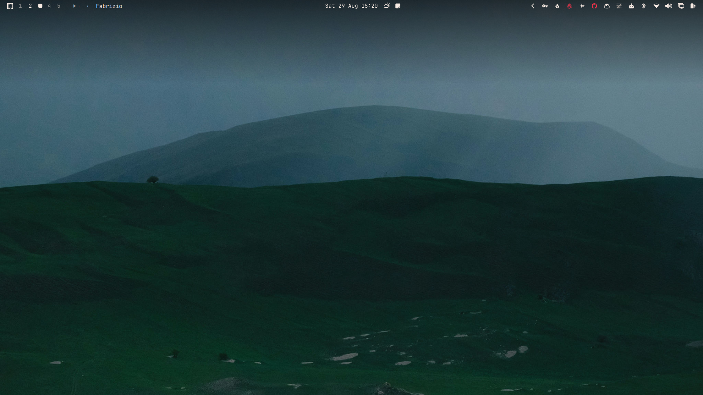
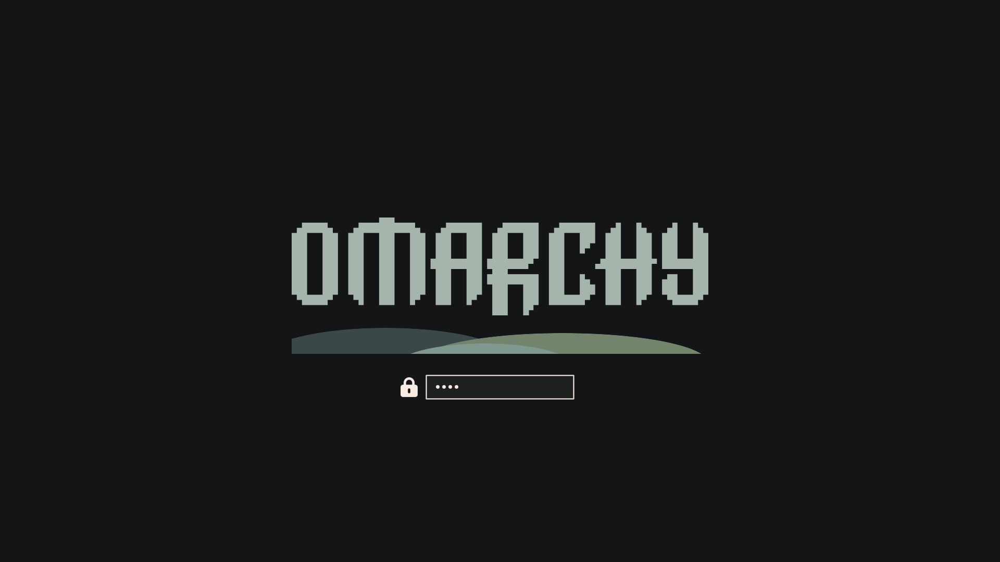

<p align="center">
  
</p>

<h1 align="center">Dos Moos</h1>

<p align="center">
  <em>A muted sage theme for <a href="https://omarchy.org/">Omarchy</a> 4 — moss hills, linen text, near-black chrome</em>
</p>

<p align="center">
  
  
</p>

Dark forest greens, ash-gray borders, and warm linen on `#131516`. The default wallpaper is **Moor**, an animated paper-cut moorland where the mist keeps drifting over the hills.

Based on [HANCORE's Dos-Moos](https://github.com/HANCORE-linux/omarchy-dos-moos-theme), with the animated Moor wallpaper, a custom Plymouth unlock screen, sage menu selection, and rounded windows. Window translucency follows Omarchy 4.5 (Appearance → Windows → Window Opacity).

## Install

```bash
omarchy theme install https://github.com/cempack/omarchy-dos-moos-theme.git
rm -rf ~/.config/omarchy/themes/dos-moos/.git
omarchy theme set dos-moos
```

Or from the Omarchy menu: **Super + Alt + Space** → **Install → Style → Theme**, paste the URL, press Enter. Then drop the leftover `.git` and re-apply, as above.

Omarchy ignores `hyprland.lua` on a cloned repo (it regenerates one from `colors.toml`). Removing `.git` makes this a user theme, so its rounding and borders load the same way stock **Solitude** does.

To use it again later:

```bash
omarchy theme set dos-moos
```

### Unlock screen (Plymouth)

After install, pick **dos-moos** in the unlock switcher, or:

```bash
omarchy plymouth set by theme dos-moos
```

That needs sudo and rebuilds the initramfs.

## Wallpaper

| File | Role |
|:---|:---|
| `backgrounds/0-moor-loop.mp4` | Default. Moor animated: 40 s seamless loop, 1080p30 H.264 |
| `backgrounds/1-moor.png` | Moor still, with an intro in `backgrounds/intros/1-moor.mp4`: 6 s, the hills fold up out of the dark |
| `backgrounds/BG1.jpg` … `BG4.jpg` | Original Dos Moos set |

Cycle with the usual next-background shortcut or `omarchy theme bg next`. Extra wallpapers of your own go in `~/.config/omarchy/backgrounds/dos-moos/`.

Omarchy plays a background intro only before a still, never before a video. So the intro comes with the still: with `1-moor.png` as your background, the intro plays at login and when you switch to Dos Moos, then settles on the still, which is the intro's last frame. The animated loop plays without an intro.

The loop is decoded on the GPU. To save battery, set `battery_mode = "pause"` (or `"poster"`) in `~/.config/owe/config.toml` (see `/usr/share/doc/owe/config.toml.example`), then run `owe reload-config`.

## Palette

| Role | Hex |
|:---|:---|
| Background | `#131516` |
| Foreground (linen) | `#F8EBE3` |
| Accent (muted sage) | `#819890` |
| Border (ash gray) | `#A5B5AB` |
| Cursor / yellow | `#F4E276` |
| Red | `#F0334A` |
| Muted (secondary text, comments) | `#72856C` |
| Selection (completion menus) | `#35352D` |

Shell menu selection uses sage, not yellow.

## Unlock preview

<p align="center">
  
</p>

## License

MIT. Original theme © 2026 HANCORE. Modifications © 2026 Elliot Moreau.

The bundled wallpapers remain the property of their original owners where that applies.
